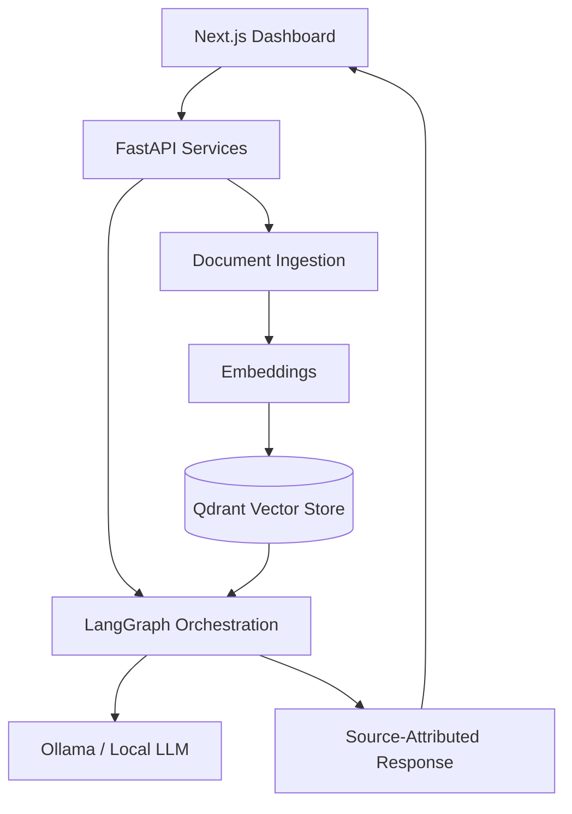
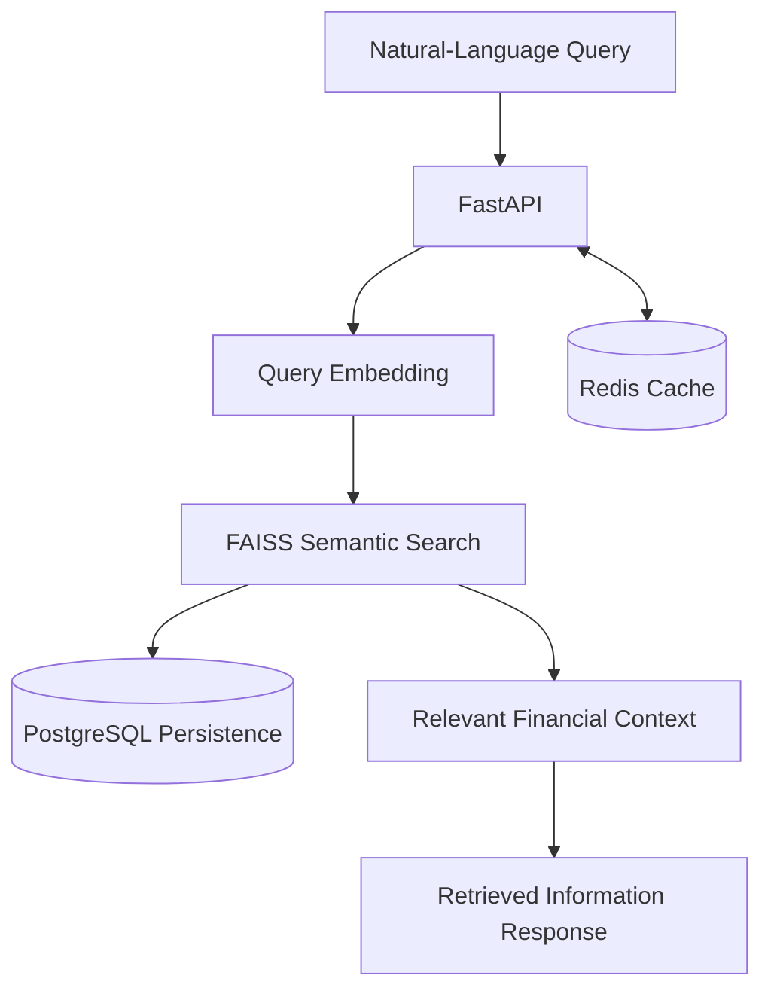

<!-- Animated lavender / violet banner, designed to complement the existing maroon embroidered hoodie profile avatar -->

 

 

  

---

<h2 align="center">✨ AADITYA'S DEVELOPER SPACE ✨</h2>

### Namaste 🙏 I'm Aaditya Maindarkar

**Software Engineer · AI/ML & Generative AI · Full-Stack Development**

*I turn ideas into intelligent applications — from agentic AI workflows to real-time collaborative systems.*

---

## 🌙 About Me

<table>
<tr>
<td width="62%" valign="top">

I'm **Aaditya Gajendra Maindarkar**, a Computer Science Engineering student specializing in Artificial Intelligence at G H Raisoni College of Engineering and Management, Pune.

I enjoy engineering products at the intersection of **Generative AI, backend systems, and full-stack development**. My work focuses on connecting models, APIs, databases, and user experiences into practical software.

- 🎓 B.Tech CSE (Artificial Intelligence), **2023–2027**
- 📊 Academic CGPA: **8.90/10.0**
- 💼 GenAI Intern — Agentic AI R&D, **OxiqAI**
- 🤖 Exploring Agentic AI, RAG, LLM integration, and semantic retrieval
- ⚡ Building with Python, FastAPI, React, Next.js, and Node.js
- 🔬 CodeBuddy — IEEE undergraduate research project
- 🧩 **55+ LeetCode problems** solved

**Engineering mindset:** Understand the problem, design the system, build with intent, and improve through measurement.

</td>
<td width="38%" align="center" valign="middle">

 

 

 

</td>
</tr>
</table>

### 🧭 Current Engineering Focus

| Area | What I work with |
|---|---|
| Generative AI | LLM integration, RAG, AI agents, prompt engineering |
| Agentic systems | LangGraph, LangChain, tool-oriented workflows |
| Backend engineering | Python, FastAPI, Flask, Node.js, REST APIs |
| Retrieval & data | Embeddings, semantic search, FAISS, Qdrant |
| Real-time systems | WebSockets, Socket.IO, Redis Pub/Sub |
| Product engineering | React, Next.js, Docker, testing, CI/CD |

---

## 🧰 Languages & Tools I Have Worked With

### Programming Languages

### Frontend & UI Engineering

### Backend & API Engineering

### AI / ML & Generative AI

 

### Databases & Data Engineering

### DevOps, Testing & Developer Tools

### 🧠 Core Computer Science

`Data Structures & Algorithms` · `Object-Oriented Programming` · `DBMS` · `Operating Systems` · `Computer Networks`

### ⚙️ Engineering Practices

`REST API Design` · `WebSockets` · `Redis Pub/Sub` · `SQL Query Optimization` · `Data Validation` · `Pytest` · `Docker Compose` · `CI/CD` · `Debugging` · `API Integration`

---

## 💼 Professional Experience

**Pune, India · June 2026 – September 2026**

- Contributed to Python/FastAPI backend services and REST APIs for AI-assisted applications.
- Worked on workflow improvements that reduced manual setup effort by **25%**.
- Examined data ingestion, validation, preprocessing, and transformation requirements.
- Integrated retrieval-based and LLM-driven components into backend workflows.

---

## 🚀 Featured Engineering Projects

<table>
<tr>
<td width="50%" valign="top">

### 🧑‍💻 CodeBuddy
**Real-Time Collaborative Code Editor**

A collaborative coding platform for real-time editing, room management, file handling, and code execution.

**Highlights**
- Socket.IO collaboration and Redis Pub/Sub
- Tested with 2–10 concurrent users
- **68.5–75.1 ms** synchronization latency in testing
- Docker-isolated code execution with timeout and resource controls

`Next.js` `Node.js` `Socket.IO` `Redis` `MongoDB` `Docker`

</td>
<td width="50%" valign="top">

### 🧠 Think9
**Central AI Engine**

A full-stack agentic AI platform connecting locally hosted Llama models, document ingestion, semantic retrieval, and source-attributed responses.

**Highlights**
- LangGraph agentic workflow orchestration
- Ollama local LLM integration
- Asynchronous document ingestion
- Qdrant semantic retrieval
- Next.js 14 dashboard, Pydantic validation, structured logging, Pytest

`Python` `FastAPI` `LangGraph` `Ollama` `Qdrant` `Next.js`

<b>View AI system architecture</b>

</td>
</tr>
<tr>
<td width="50%" valign="top">

### 📈 FineMind
**Financial Intelligence Platform**

A financial information retrieval platform designed to retrieve relevant financial information through natural-language queries.

**Highlights**
- Data preprocessing and embeddings
- FAISS semantic similarity search
- PostgreSQL persistence
- Redis caching

`Python` `FastAPI` `PostgreSQL` `Redis` `FAISS`

<b>View retrieval architecture</b>

</td>
<td width="50%" valign="top">

### 🏅 IEEE Undergraduate Research
**CodeBuddy Research Project**

CodeBuddy was also recognized as an undergraduate research project through IEEE.

**Engineering themes**
- Real-time collaboration
- Distributed application components
- Containerized code execution
- Performance measurement

</td>
</tr>
</table>

> CodeBuddy is linked to its verified public repository. Think9 and FineMind are described from my CV; their exact public repository URLs are not linked yet.

---

## 📊 GitHub Stats & Developer Analytics

  

### 🏅 GitHub Trophy Cabinet

---

## 🧩 Tech Stack — Engineering Domains

  

  

  

  

---

## ⭐ Pinned & Public Repositories

**More public repositories:** [Aaditya](https://github.com/Aaditya8459/Aaditya) · [IRTM-Project](https://github.com/Aaditya8459/IRTM-Project) · [MyPortfolio](https://github.com/Aaditya8459/MyPortfolio) · [ExproTech-New](https://github.com/Aaditya8459/ExproTech-New) · [All repositories](https://github.com/Aaditya8459?tab=repositories)

---

## 💬 Random Developer Quote

---

## 🎓 Certifications & Achievements

---

## 🎓 Education

**G H Raisoni College of Engineering and Management**  
B.Tech — Computer Science Engineering (Artificial Intelligence)  
Pune, India · `2023–2027`

Relevant coursework: Data Structures & Algorithms · Object-Oriented Programming · DBMS · Operating Systems · Computer Networks.

---

## 🐍 Contribution Activity

---

## ☕ Support & Collaborate

If you find my projects interesting, explore my repositories, share feedback, or connect for a technical collaboration.

---

### 🌌 Namaste! Thanks for visiting my corner of GitHub.

**Building intelligent systems · Engineering meaningful solutions · Learning every day**

