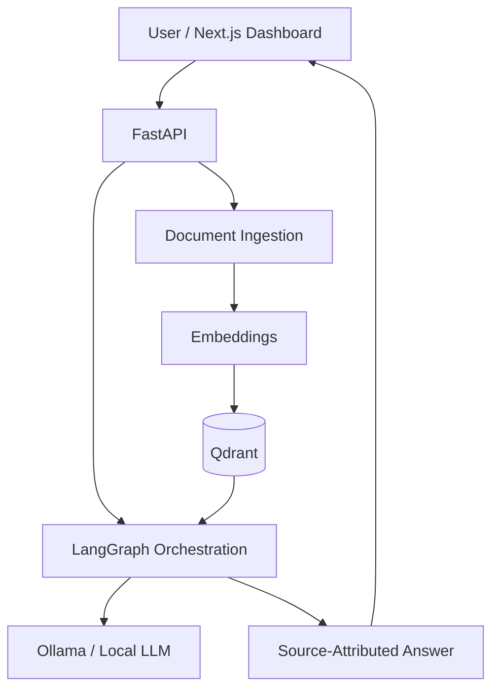
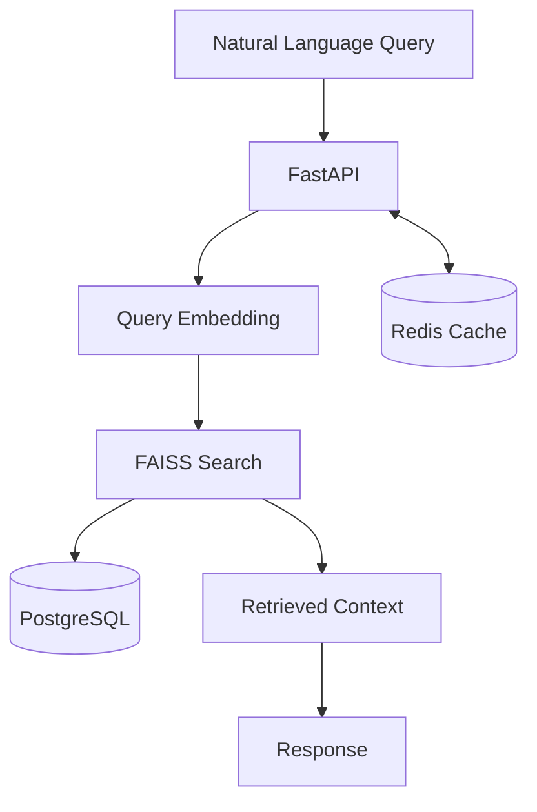
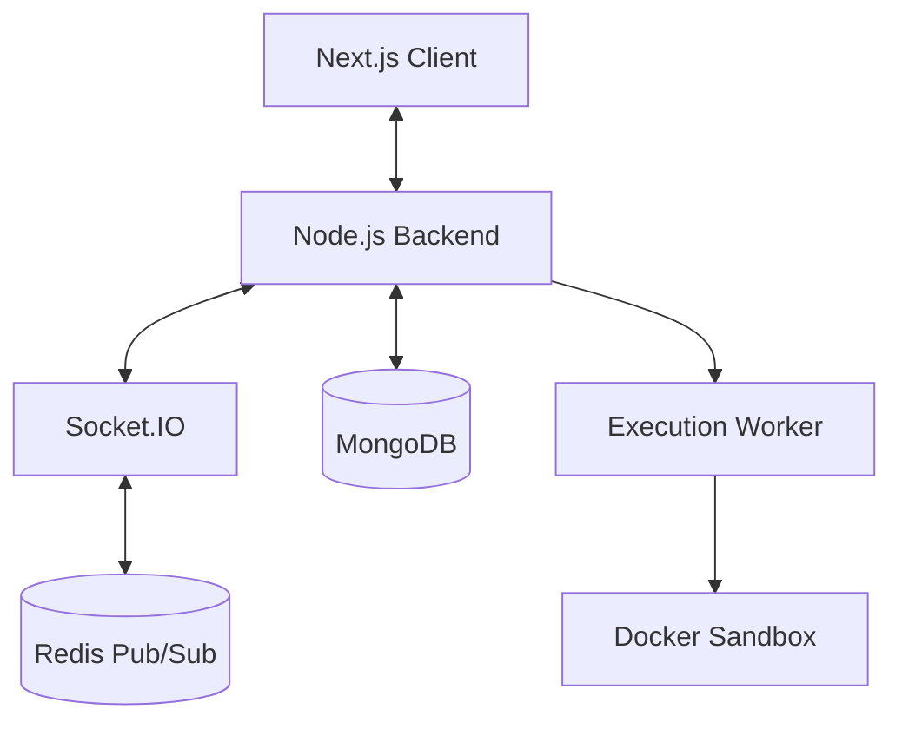

<div align="center">


<br/>


<br/>

<a href="https://aadigm-portfolio.vercel.app/"></a>
<a href="https://www.linkedin.com/in/aaditya-maindarkar-848427295/"></a>
<a href="https://leetcode.com/u/AadityaGM/"></a>
<a href="mailto:adityamaindarkar@gmail.com"></a>

<br/><br/>


</div>

---

<div align="center">

## AI, Made Clear. Prompts, Made Powerful.

**Prompt Engineering · Generative AI · AI Tool Instruction · Agentic Systems**

I explore how people can communicate more effectively with AI—and how those interactions can become reliable, useful software workflows.

</div>

## `01 / PROFILE` — The Person Behind the Prompts

<table>
<tr>
<td width="64%" valign="top">

I'm **Aaditya Gajendra Maindarkar**, a Computer Science Engineering (Artificial Intelligence) student and software developer based in Pune, India.

My work sits at the intersection of **prompt engineering, Generative AI, AI-assisted workflows, and full-stack engineering**. I enjoy breaking down complex AI concepts into practical steps, designing structured prompts, and building applications that connect language models with real data and tools.

- **Professional positioning:** Prompt Engineer & AI Tools Instructor
- **Engineering foundation:** Python, FastAPI, JavaScript/TypeScript, React, Next.js
- **AI focus:** Prompt design, LLM integration, RAG, embeddings, AI agents
- **Workflow stack:** LangChain, LangGraph, Ollama, Qdrant, FAISS
- **Industry experience:** GenAI Intern — Agentic AI R&D, OxiqAI
- **Education:** B.Tech CSE (Artificial Intelligence), 2023–2027
- **Academic record:** 8.90/10.0 CGPA
- **Problem solving:** 55+ LeetCode problems

</td>
<td width="36%" align="center" valign="middle">


<br/><br/>


<br/>

<br/>


</td>
</tr>
</table>

---

## `02 / PROMPT ENGINEERING` — From Instructions to Outcomes

<div align="center">


</div>

I approach prompt engineering as a practical discipline: define the outcome, provide the right context, set constraints, specify the output, and evaluate the result.

| Capability | Practical application |
|---|---|
| Instruction design | Clear roles, goals, context, constraints, and output formats |
| Zero-shot & few-shot prompting | Guide tasks with examples and demonstrations |
| Structured outputs | Consistent JSON, tables, schemas, and step-by-step responses |
| Prompt iteration | Compare outputs, identify failure patterns, refine instructions |
| Context engineering | Supply relevant information and reduce ambiguity |
| AI workflow design | Connect prompts with retrieval, tools, and application logic |
| Responsible AI usage | Validate outputs, recognize limitations, and retain human review |

### A reusable prompt blueprint

```text
ROLE            Define the expertise and perspective the AI should adopt.
CONTEXT         Provide background, source material, and constraints.
TASK            State the exact outcome and actions required.
QUALITY RULES   Define accuracy, tone, boundaries, and evaluation criteria.
OUTPUT FORMAT   Specify the structure, length, and response format.
ITERATION       Review the result, identify gaps, and refine the prompt.
```

---

## `03 / AI TOOL INSTRUCTION` — Learn the Workflow, Not Just the Tool

My instruction focus is to make AI concepts approachable and actionable—helping learners understand what a tool can do, how to guide it, and how to evaluate its output.

<table>
<tr>
<td width="50%" valign="top">

### AI fundamentals
- How large language models work at a practical level
- Strengths, limitations, and hallucinations
- Choosing the right AI approach for a task
- Human review and responsible use

### Prompting practice
- Writing clear, context-rich prompts
- Few-shot examples and reusable templates
- Structured responses and output constraints
- Iterative prompt improvement

</td>
<td width="50%" valign="top">

### Productivity workflows
- Research and information synthesis
- Writing, summarization, and ideation
- Coding assistance and debugging support
- Repeatable AI-assisted workflows

### Developer-focused AI
- LLM APIs and integrations
- Retrieval-Augmented Generation (RAG)
- Tool calling and agentic workflows
- Evaluation, validation, and observability

</td>
</tr>
</table>

*These are the instruction and knowledge-sharing topics I want this profile to communicate; formal teaching engagements or course credentials are not claimed.*

---

## `04 / AI & ENGINEERING STACK` — Tools I Work With

<div align="center">

### Prompting, LLMs & AI Orchestration


### Retrieval & Knowledge Systems


### Programming Languages


### Full-Stack & Backend


### AI Frameworks & Libraries

**Machine Learning, Data Science & Visualization**


**Deep Learning & Computer Vision**


**Generative AI, LLMs & Agentic AI**


**RAG, Vector Search & Embeddings**


**LLM Evaluation, Observability & Experiment Tracking**


### Data, Databases & Infrastructure


</div>

**Additional engineering skills:** REST APIs · WebSockets · Socket.IO · Redis Pub/Sub · Pytest · Docker Compose · CI/CD · SQL query optimization · Data preprocessing · Data validation · Debugging · API integration.

---

## `05 / SELECTED WORK` — AI & Software Projects

<table>
<tr>
<td width="50%" valign="top">

### ◈ Think9 — Central AI Engine

A full-stack agentic AI platform built around local LLMs, document ingestion, semantic retrieval, and source-attributed responses.

**What it demonstrates**
- LangGraph-based agentic workflows
- Ollama-hosted Llama models
- Asynchronous document ingestion
- Qdrant semantic retrieval
- FastAPI services and Next.js 14 dashboard
- Pydantic validation, structured logging, Pytest

`Python` `FastAPI` `LangGraph` `Ollama` `Qdrant` `Next.js`

</td>
<td width="50%" valign="top">

### ◈ FineMind — Financial Intelligence

A natural-language financial information retrieval platform.

**What it demonstrates**
- Data preprocessing and embeddings
- FAISS semantic search
- PostgreSQL persistence
- Redis caching
- API-oriented backend design

`Python` `FastAPI` `PostgreSQL` `Redis` `FAISS`

</td>
</tr>
<tr>
<td width="50%" valign="top">

### ◈ CodeBuddy — Collaborative Code Editor

A real-time collaborative coding platform with editing, room management, file handling, and isolated code execution.

**What it demonstrates**
- Socket.IO and Redis Pub/Sub
- 2–10 concurrent users tested
- 68.5–75.1 ms synchronization latency in testing
- Docker-isolated execution with timeout and resource controls

`Next.js` `Node.js` `Socket.IO` `Redis` `MongoDB` `Docker`

<a href="https://github.com/Aaditya8459/CodeBuddy"></a>

</td>
<td width="50%" valign="top">

### ◈ Prompt Engineering Practice

A growing space for reusable prompt patterns, AI workflow experiments, and practical examples.

**Planned repository content**
- Prompt templates by task and use case
- Before/after prompt refinements
- Structured output examples
- AI workflow walkthroughs
- Evaluation checklists

*Publish a dedicated repository when the examples are ready.*

</td>
</tr>
</table>

<details>
<summary><b>Think9 — high-level architecture</b></summary>


</details>

<details>
<summary><b>FineMind — high-level architecture</b></summary>


</details>

<details>
<summary><b>CodeBuddy — high-level architecture</b></summary>


</details>

---

## `06 / EXPERIENCE` — Applied GenAI Engineering

<div align="center">


**Pune, India · June 2026 – September 2026**
</div>

- Contributed to Python/FastAPI backend services and REST APIs for AI-assisted applications.
- Worked on workflow improvements that reduced manual setup effort by **25%**.
- Examined data ingestion, validation, preprocessing, and transformation requirements.
- Integrated retrieval-based and LLM-driven components into backend workflows.

---

## `07 / GITHUB ANALYTICS` — Activity Dashboard

<div align="center">


<br/>


<br/>


<br/>


</div>

---

## `08 / TEACHING TOOLBOX` — What I Can Help Explain

<div align="center">


</div>

- **For learners:** Understand prompt structure, model behavior, and practical AI use cases.
- **For creators:** Build repeatable ideation, writing, and research workflows.
- **For developers:** Connect LLMs to APIs, data sources, retrieval, and application logic.
- **For teams:** Think through AI workflow design, validation, and human review.

---

## `09 / CREDENTIALS & EDUCATION`

| Recognition | Details |
|---|---|
| Oracle | Agentic AI Certified Foundations Associate |
| Google Cloud | Introduction to Generative AI |
| IEEE | CodeBuddy — Undergraduate Research Project |
| LeetCode | 55+ problems solved |
| Education | B.Tech CSE (Artificial Intelligence), 2023–2027 |
| Academic performance | 8.90/10.0 CGPA |

**G H Raisoni College of Engineering and Management** · Pune, India

Relevant coursework: Data Structures & Algorithms · OOP · DBMS · Operating Systems · Computer Networks.

---

## `10 / CONTRIBUTION SIGNAL` — Keep Building

<div align="center">


</div>

*The contribution animation is published by the included GitHub Actions workflow after its first successful run.*

---

## `11 / CONNECT` — Learn, Build & Collaborate

I'm interested in prompt engineering, practical AI education, GenAI applications, and engineering reliable AI-powered products.

<div align="center">

<a href="https://aadigm-portfolio.vercel.app/"></a>
<a href="https://www.linkedin.com/in/aaditya-maindarkar-848427295/"></a>
<a href="https://leetcode.com/u/AadityaGM/"></a>
<a href="mailto:adityamaindarkar@gmail.com"></a>

<br/><br/>

### Clear prompts. Useful AI. Thoughtful engineering.


</div>
